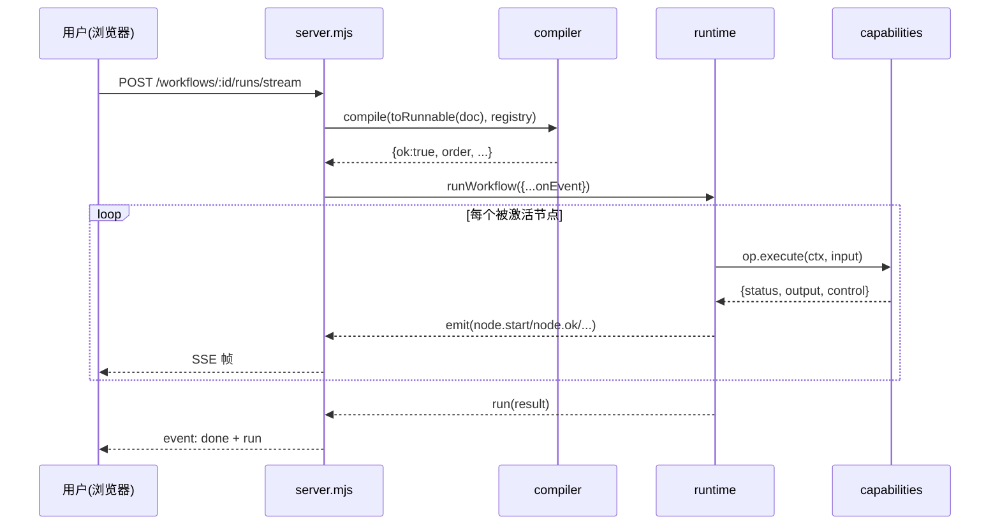

# 云崽 Flow 可视化工作流插件 — 交接文档

> **文档版本**：1.0　**交付日期**：2026-11-16　**代码版本**：`0.1.0`（MVP）
> **仓库**：<https://github.com/baigeiruogui/yunzai-flow-plugin>（分支 `main`）
> **本地路径**：`/Deepseek HARNESS/plugins/yunzai-flow-plugin`
> **适用读者**：接手本项目的工程师 / 运维 / 二次开发者。本文假设你熟悉 Node.js 与 HTTP，但不了解本项目。

---

## 0. 怎么读这份文档

| 你的角色 | 建议先读 |
|---|---|
| 只想跑起来看看 | §1 速览 → §6 快速开始 |
| 要接手维护/改代码 | §5 目录 → §8 架构 → §9 数据模型 → §11 执行引擎 → §20 二次开发 |
| 要部署/运维 | §7 配置 → §16 存储 → §19 运维手册 |
| 要对接真实 QQ | §13 NapCat 集成 → §19 切直连 |
| 关心质量/验收 | §17 测试与质量 → §21 已知限制 |

> 本文档所有数字（家族数、操作数、覆盖率、事件数、测试数等）均取自当前代码实际运行结果，非估算。若代码变动请以 `npm run check` 与 `GET /api/flow/v1/coverage` 的实时输出为准。

---

## 1. 一页速览（TL;DR）

**它是什么**：一个按《云崽可视化工作流插件 开发文档 v1.0》实现的 **ComfyUI 风格可视化节点编排插件**，用于给 Yunzai/QQ 机器人编排"事件触发 → 处理 → 发消息"的流程。用户在前端画布拖节点、连线、运行；后端编译成 DAG 并执行，可实时看轨迹，最终通过 NapCat（OneBot 11）把消息发到 QQ。

**技术栈**：**零外部依赖**的 Node.js ESM 后端 + **无构建**的原生 JS 前端（单页）。存储用内置 `node:sqlite`（失败回退 JSON 文件）。前端通过 REST + SSE 与后端通信。

**一句话跑起来**：
```bash
cd /Deepseek HARNESS/plugins/yunzai-flow-plugin
node src/server.mjs          # 默认 http://127.0.0.1:5088
```
浏览器打开后用首次引导点「开始编辑」即可操作。默认空库会自动注入 11 个示例流程。

**关键数字**（`GET /api/flow/v1/coverage` 实时值）：

| 指标 | 值 |
|---|---|
| 节点家族 / 操作 | **28 / 211** |
| 操作 effect 分布 | pure 28 · read 81 · write 3 · send 27 · admin 72 |
| NapCat 基础操作映射 | **178**（结构化表单 178，通用表单 0） |
| 契约测试 | 结构 178 · 可执行 178 · 行为 2 · **实机 0** |
| 事件目录 | 38（supported 26 / opt-in 2 / conditional 9 / preserve 1） |
| 数据源包 / AI 工具 | 2 / 2 |
| 预置示例流程 | 11 |
| 自动化测试 | 55（单元/集成）+ API 27 + 桌面 UI 15 + 移动端 8 |
| Node 要求 | **≥ 22**（开发实测 Node 24） |

**常用命令**：
```bash
npm start        # 启动服务（= node src/server.mjs）
npm test         # 全部单元/集成测试
npm run check    # 全量：test + API 冒烟 + 桌面 UI 冒烟 + 移动端冒烟
npm run verify   # 生成 docs/ACCEPTANCE.md 验收快照
```

---

## 2. 项目定位与设计原则

### 2.1 定位与范围
- 这是文档的 **M0/M1 纵向切片**：把"画布 → 编译 → 执行 → 观测 → 发布 → 导出"这条主链路打通并做扎实，而不是把文档里所有功能都铺满。
- **已实现**：可视化编辑、控制流（条件/循环/合流/Switch/Try-Catch/Stop）、30+ 能力操作、NapCat 178 项操作的元数据与表单映射、事件规范化、子图、数据源、导入导出、备份恢复、配对鉴权、直连 OneBot、SSE 实时轨迹、四层自动化测试。
- **未实现/需真实环境**：真实 NapCat 实机联调、真实 TRSS-Yunzai 宿主挂载、`wait/Delay` 持久化检查点、23 类消息段（仅 text）、AI/Agent 工具链、权限审批流 UI。

### 2.2 设计原则（为什么这样写，接手时要守住）
1. **零外部依赖**：`package.json` 的 `dependencies` 为空。DB 用 Node 内置 `node:sqlite`，HTTP/Socket 用 `node:http`，加密用 `node:crypto`。好处：部署无供应链风险、无 `npm install`。**不要随意引第三方包**。
2. **前端无构建**：`web/` 下原生 HTML/CSS/JS，直接由后端静态托管，改完刷新即生效（已加 `Cache-Control: no-store` 防旧缓存）。
3. **契约与实现分离**：节点/事件/数据源/传输都是"声明 + 运行"两层。节点在 `src/registry.mjs` 声明 `inputSchema/outputSchema/effect/requiredCapabilities/execute`，引擎与前端都只认契约。
4. **幂等与可审计**：每次运行有 `runId`；副作用进"effect ledger"；`simulate` 模式**绝不产生真实副作用**（只记账）；事件按 `botId|eventId|workflowId|triggerId` 去重。
5. **覆盖率分轴、不注水**：NapCat 覆盖按"映射/结构化表单/通用表单/结构契约/可执行契约/行为契约/实机"分轴统计，绝不拿"节点数"冒充"实机全覆盖"。
6. **敏感信息默认安全**：导出/备份/运行快照都不含凭据正文；运行输出统一脱敏；密钥加密落盘。

---

## 3. 术语表

| 术语 | 含义 |
|---|---|
| 家族 Family | 一组相关操作的集合，如 `qq.message`（QQ 消息）。 |
| 操作 Operation | 家族下的一个具体动作，如 `send_msg`。节点是"家族+操作"的一个实例。 |
| 控制边 controlEdge | 决定"执行顺序"的实线连接，带端口名（`next`/`true`/`false`/`body`/`done`/`case…`）。 |
| 绑定 binding | 数据边（虚线）：`{ kind:'ref', nodeId, pointer }`，用 **JSON Pointer (RFC 6901)** 从上游节点输出取值并写到当前节点某个输入路径。 |
| 端口 port | 节点上与连线相连的锚点，声明在 `operation.ports`（`in`/`out` 列表）。 |
| 副作用 Effect | 对外部世界的改变（发消息、改群、写缓存等），按 effect 分类 pure/read/write/send/admin。 |
| 运行 Run | 一次执行实例，含状态机与轨迹，落库可回溯。 |
| 子图 Subgraph | 可被 `core.subgraph/call` 复用的已发布流程片段，带版本与内容哈希锁。 |
| 数据源 DataSource | 外部数据/能力（如用户资料、天气），可被画布/工具/节点调用。 |
| 覆盖率分轴 | 见 §13.5，避免"映射了"被误读为"实机验证了"。 |

---

## 4. 系统架构

### 4.1 分层

```
┌──────────────────────────────────────────────────────────────┐
│ 前端编辑器（web/：index.html + app.js + style.css，无构建）      │
│  画布/检查器/运行面板/节点库/历史/导入导出/传输设置             │
└───────────────▲───────────────────────────────┬──────────────┘
                │ REST(JSON) + SSE              │ 静态资源(/app.js…)
┌───────────────┴───────────────────────────────▼──────────────┐
│ HTTP 控制层 src/server.mjs（路由/鉴权/SSE/静态/脱敏/限额调度）   │
└──────┬───────────────┬───────────────┬───────────────┬────────┘
       │               │               │               │
 ┌─────▼─────┐  ┌──────▼──────┐  ┌─────▼──────┐  ┌─────▼──────┐
 │ 编译 compiler│ │ 执行 runtime │  │ 注册表 registry │  │ 能力 capabilities│
 └───────────┘  └──────┬──────┘  └────────────┘  └─────┬──────┘
                       │                                │
        ┌──────────────┼───────────────┬────────────────┼───────────┐
   ┌────▼────┐   ┌─────▼─────┐   ┌─────▼─────┐   ┌──────▼──────┐ ┌──▼───┐
   │ storage │   │ scheduler │   │ events    │   │ datasource  │ │ code │
   │(sqlite/ │   │ (并发限额) │   │ (事件目录) │   │ (数据源)     │ │子进程 │
   │ json)   │   └───────────┘   └───────────┘   └─────────────┘ └──────┘
   └─────────┘
        │
   ┌────▼────────────────────────────────────────────┐
   │ 集成层 integrations/napcat（manifest + transport） │──▶ NapCat/OneBot 11
   └──────────────────────────────────────────────────┘
```

### 4.2 一次典型请求的数据流
1. 前端 `bootstrap()` → `GET /bootstrap` 拿到宿主状态、传输模式、节点家族清单、工作流列表、覆盖率、密钥元信息。
2. 前端 `loadWorkflow(id)` → `GET /workflows/:id`，拿到流程文档 + 编译校验结果；`renderNodes/renderEdges` 渲染画布。
3. 用户点「运行」→ `POST /workflows/:id/runs/stream`（SSE）；后端 `compile()` 校验 DAG → `runWorkflow()` 执行。
4. 执行中后端按事件推送 `run.start / node.start / node.ok / node.fail / loop.iteration / run.end`，末帧 `event: done` 携带最终 run。
5. 前端 `handleRunEvent` 逐帧更新节点状态/轨迹/日志/回执；结束后写入运行历史。
6. 运行时若有副作用，进入 effect ledger；`simulate` 模式下只记账不真发。

### 4.3 运行时序（简）



---

## 5. 目录结构与文件职责

```
yunzai-flow-plugin/
├── index.js                     # 宿主导入入口（Yunzai 插件生命周期桥接，独立运行时不用）
├── package.json                 # 元数据、engines(node>=22)、scripts、零依赖
├── config/config.json           # 运行配置（见 §7）；仓库内为默认值
├── src/
│   ├── server.mjs               # HTTP 控制 API + SSE + 静态托管 + 鉴权 + 脱敏 + 限额调度装配
│   ├── registry.mjs             # 节点注册表：28 家族 211 操作的 Schema/effect/execute（唯一真源）
│   ├── compiler.mjs             # 编译校验：DAG/端口/绑定/权限/环检测（Kahn），输出执行顺序
│   ├── runtime.mjs              # 执行引擎：控制流激活、分支/循环/合流/TryCatch/Stop、去重、重试、SSE
│   ├── capabilities.mjs         # 能力服务：Secret/Cache/Crypto/Http/QQ/Render/DataSource + capability client
│   ├── storage.mjs              # 存储：JSON Store / SqliteStore / SubgraphStore / createStore
│   ├── scheduler.mjs            # 运行限额：全局并发、每会话串行、排队与背压
│   ├── events.mjs               # 事件规范化 normalizeEvent + 事件目录(38)
│   ├── datasource.mjs           # 数据源声明与运行时（画布/SDK/REST 共用，工具只导读操作）
│   ├── portability.mjs          # 导出/导入/备份/恢复（不含凭据，导入默认停用，恢复前备份）
│   ├── auth.mjs                 # 配对码 → Bearer token 鉴权
│   ├── help.mjs                 # 节点帮助目录（22 条）
│   ├── seed.mjs                 # 空库注入 11 个示例流程 + 1 个子图
│   ├── host/adapter.mjs         # 宿主探测（host vs diagnostic）
│   ├── code/supervisor.mjs      # 代码节点父进程：派生 worker、超时 SIGKILL、stdin/stdout 协议
│   ├── code/worker.mjs          # 代码节点子进程：执行用户 JS，模拟模式禁网，结果可序列化
│   └── integrations/napcat/
│       ├── manifest.mjs         # NapCat 元数据合并（手写 overlay 优先于源码生成）+ 分轴统计
│       └── transport.mjs        # OneBot HTTP/WS 传输 + 适配器（echo 关联、retcode 判定）
├── web/
│   ├── index.html               # 单页结构：顶栏/节点库/画布/检查器/运行面板/弹窗
│   ├── app.js                   # 编辑器逻辑（742→~911 行，含增量渲染/SSE/撤销重做）
│   └── style.css                # 深色主题 + 三栏布局 + 移动端适配
├── schemas/napcat/4.18.38/actions.json      # 由文档 §26.1 解析出的 178 项基础操作
├── overlays/napcat/4.18.38/
│   ├── actions.overlay.json                 # 手写结构化表单覆盖（85 条，人工精选）
│   └── actions.generated.json               # 从 NapCatQQ 源码 TypeBox 提取（147 条，启发式）
├── datasources/demo.user-profile.json       # 示例数据源：用户资料（读/写）
├── datasources/demo.weather.json            # 示例数据源：天气（读）
├── scripts/
│   ├── api-smoke.mjs            # API 冒烟（27 项，含负例）
│   ├── ui-smoke.mjs             # 桌面 UI 冒烟（15 项，依赖 camofox）
│   ├── ui-smoke-mobile.mjs      # 移动端冒烟（8 项，390px iframe）
│   ├── mock-onebot.mjs          # 本地 OneBot 11 协议服务器（端口 5701），用于直连真链路验证
│   ├── bench.mjs                # 性能基准（500 节点编译/运行）
│   ├── verify.mjs               # 生成 docs/ACCEPTANCE.md
│   ├── generate-napcat.mjs      # 解析文档 §26.1 → schemas/…/actions.json
│   └── gen-forms-from-source.mjs# 抓 NapCatQQ 源码 TypeBox → actions.generated.json
├── test/
│   ├── engine.test.mjs          # 执行/能力/存储/契约/黄金流程等（~50 项）
│   ├── scheduler.test.mjs       # 并发/串行/背压
│   └── contract.test.mjs        # 178 项结构与可执行契约
└── docs/                        # 交付/对照/质量/验收/性能 报告 + 46 张截图
    ├── 交付报告.md  实现对照报告.md  质量报告.md  交接文档.md(本文)
    ├── ACCEPTANCE.md  PERFORMANCE.md
    └── screenshots/*.png
```

---

## 6. 快速开始

### 6.1 环境要求
- **Node.js ≥ 22**（`package.json` 的 `engines`）；开发与测试在 **Node 24** 上验证。SQLite 驱动依赖 `node:sqlite`（22.5+，24 稳定）。
- 无第三方依赖，**无需 `npm install`**。
- 磁盘可写（默认在 `data/` 下建库、密钥、备份）。

### 6.2 启动
```bash
cd /Deepseek HARNESS/plugins/yunzai-flow-plugin
node src/server.mjs
# 或 npm start
```
默认监听 `http://127.0.0.1:5088`。首次启动会自动：
1. 建 `data/` 目录与数据库；
2. 生成主密钥 `data/.secret.key` 与加密的 `data/secrets.json`（含 3 个 demo 密钥）；
3. **空库时**注入 11 个示例流程与 1 个子图。

浏览器访问 `http://127.0.0.1:5088/`，点首次引导的「开始编辑」即可。

### 6.3 端口 / 主机覆盖
```bash
HOST=0.0.0.0 PORT=8080 node src/server.mjs
```
| 环境变量 | 作用 | 默认 |
|---|---|---|
| `PORT` | HTTP 端口 | `config.web.port`（5088） |
| `HOST` | 绑定地址 | `config.web.host`（127.0.0.1） |
| `YF_SECRET_KEY` | 密钥主密钥（hex 64 / base64 32 / 任意字符串经 sha256 派生）。设置则不用 `.secret.key` | 无（用 `.secret.key`） |
| `CAMOFOX_URL` | 跑 UI 冒烟时的 camofox REST 地址 | `http://127.0.0.1:9377` |

### 6.4 作为 Yunzai 插件接入（宿主）
`index.js` 仅做生命周期桥接（`YunzaiFlowPlugin.init/dispose`）。在真实云崽宿主中由宿主 `import` 本插件；当前独立运行时**不经过** index.js。真实宿主挂载尚未在真实环境验证（见 §21）。

---

## 7. 配置详解 `config/config.json`

> 修改后需重启进程生效。仓库内为默认值，可安全提交（不含凭据）。

| 路径 | 含义 | 默认/取值 |
|---|---|---|
| `configVersion` | 配置结构版本 | `1` |
| `web.enabled` | 是否启用 Web 控制台 | `true` |
| `web.host` / `web.port` | 监听地址/端口 | `127.0.0.1` / `5088` |
| `web.basePath` | 预留：反代挂载前缀（当前版本 API 固定 `/api/flow/v1`，静态在根） | `/flow` |
| `web.trustedOrigins` | 额外允许的 CORS 来源（本地默认同源） | `[]` |
| `web.requireAuth` | 是否要求 Bearer 鉴权（生产建议 `true`） | `false` |
| `host.adapter` | 宿主适配器标识 | `trss-yunzai` |
| `host.redis` | Redis 策略（复用宿主） | `reuse-host` |
| `host.renderer` | 渲染策略（优先宿主） | `prefer-host` |
| `storage.driver` | 存储驱动 | `sqlite`（或 `json`） |
| `storage.database` | SQLite 文件（相对项目根） | `data/flow.sqlite` |
| `storage.resources` | 生成资源目录（如出图 SVG） | `data/resources` |
| `runtime.maxActiveRuns` | 全局最大并发运行 | `8` |
| `runtime.maxActivePerConversation` | **每会话**最大并发（=1 即串行） | `1` |
| `runtime.queueLimit` | 排队上限，超出返回 429 | `100` |
| `runtime.runTimeoutMs` | 整轮运行超时 | `60000` |
| `runtime.nodeTimeoutMs` | 单节点超时（能力调用 budget） | `10000` |
| `runtime.maxIterations` | 循环最大迭代（防死循环） | `1000` |
| `runtime.defaultMaxAttempts` | 节点默认重试次数 | `1` |
| `napcat.schemaVersion` | NapCat schema 版本标识 | `4.18.42` |
| `napcat.connectionMode` | 连接策略 | `host-first` |
| `napcat.allowFallbackConnection` | 是否允许回退连接 | `false` |
| `napcat.httpUrl` / `wsUrl` / `accessToken` | 直连 OneBot 端点与 token（可被 `POST /transport` 覆盖） | `""` |
| `code.mode` | 代码节点执行模式 | `owner-trusted-process` |
| `code.unreviewedImports` | 未审导入策略 | `disabled` |
| `code.timeoutMs` | 代码节点超时 | `3000` |
| `retention.runDays` | 运行记录保留天数 | `7` |
| `retention.persistMessageBody` | 是否持久化消息正文（隐私） | `false` |

---

## 8. 数据模型

> 存储为 JSON 文档（SQLite 下同样是 JSON 序列化）。以下字段来自真实落库样例。

### 8.1 流程文档 WorkflowDoc
```jsonc
{
  "workflowSchemaVersion": 1,
  "id": "wf_hello",                 // wf_ 前缀
  "title": "群欢迎 · /你好",
  "revision": 1,                    // 草稿修订号，PUT 时用于乐观并发(If-Match/409)
  "workflowVersion": 0,             // 发布版本号，0=未发布
  "enabled": true,                  // 发布后置 true；restore 后全部置 false
  "permissions": { "bots": ["bot_demo"], "groups": ["group_10086"], "capabilities": [] },
  "graph": { "nodes": [ ... ], "controlEdges": [ ... ] },
  "dependencies": { "subgraphs": [], "datasources": [] },
  "ui": { "groups": [ { "id": "g1", "name": "分组", "nodeIds": ["a","b"] } ], "viewport": { "x":0, "y":0, "zoom":1 } },
  "createdAt": "2026-11-14T...Z",
  "updatedAt": "2026-11-14T...Z"
}
```
- `permissions.bots/groups`：该流程允许作用的对象白名单；`capabilities`：声明的能力白名单（编译时汇总校验）。
- `ui`：纯前端展示数据，**不参与执行**。

### 8.2 节点 Node
```jsonc
{
  "id": "trigger_1",                // 图内唯一
  "type": "core.trigger",           // 家族 type
  "familyVersion": "1.0.0",
  "operation": "command",           // 家族内操作 id
  "operationVersion": "1.0.0",
  "params": { "event": "message.group", "command": "/签到", "groups": [] }, // 静态参数
  "bindings": {                     // 数据绑定：输入路径 → 上游引用或字面量
    "/variables/n": { "kind": "ref", "nodeId": "incr_1", "pointer": "/value" }
  },
  "position": { "x": 40, "y": 180 } // 仅画布坐标，不参与执行
}
```

### 8.3 控制边 ControlEdge
```jsonc
{ "from": { "nodeId": "cond_1", "port": "true" }, "to": { "nodeId": "tmpl_ok", "port": "in" } }
```
- `port` 必须存在于源节点的 `operation.ports.out` 与目标节点的 `ports.in`。
- 决定了执行顺序；与 `bindings`（数据流）**相互独立**。

### 8.4 绑定与 JSON Pointer
- 指向数据：`{ "kind": "ref", "nodeId": "upstream", "pointer": "/a/b/0" }`，`pointer` 为 RFC 6901（`/` 分隔，`~1`=`/`，`~0`=`~`）。
- 字面量：直接写值。
- 取不到值：按 schema 决定报错或给默认（见编译/运行校验）。

### 8.5 secretRef（密钥句柄，绝不序列化值）
```jsonc
{ "kind": "secretRef", "id": "demo_aes", "version": 1 }
```
节点参数里引用密钥只放这个句柄；运行时由 `SecretService.resolve` 解析，导出/快照只保留句柄。

### 8.6 运行记录 Run
```jsonc
{
  "runId": "run_32a9d000",
  "workflowId": "wf_hello",
  "workflowVersion": 0,
  "mode": "simulate",             // simulate | real
  "status": "succeeded",          // succeeded | failed | skipped
  "deduped": false,               // 是否被去重拦截
  "startedAt": "...", "endedAt": "...", "ms": 1,
  "event": { "eventId": "...", "chat": {"type":"group","id":"group_10086"},
             "sender": {"userId":"10001","nickname":"小明"}, "message": {"text":"/你好"} },
  "nodes": [ { "nodeId":"trigger_1","type":"core.trigger","operation":"command",
               "status":"succeeded","ms":0,"startedAt":"...","output":{...},
               "control":"next","effect":"read","attempts":1 } ],
  "logs": [ { "at":"...", "level":"info", "msg":"..." } ],
  "effects": [ ... ],             // 见 8.7
  "receipts": [ ... ],            // 发送回执（message_id/target/message/simulated）
  "botId": "bot_demo"
}
```

### 8.7 副作用账本 Effect（effect ledger）
```jsonc
{
  "effectId": "eff_a5977d88", "runId": "run_32a9d000", "kind": "qq.send",
  "input": { "target": {"type":"group","id":"group_10086"},
             "message": [{"type":"text","data":{"text":"你好，张三！👋"}}] },
  "at": "...", "status": "confirmed", "result": { "message_id": "sim_msg_1e7cada4" },
  "simulated": true, "effectState": "none"   // simulate 下 effectState=none，表示未真实产生副作用
}
```
- `simulate` 模式：只记录 `effectState:'none'`，**不真发**。`real` 模式经 NapCat 传输真实发送并回执。

### 8.8 子图 Subgraph 与版本快照
- 子图：`{ id, version, graph, publicInputs, publicOutputs, contentHash }`，`contentHash` 只锁"结构内容"（graph + 公开入参/出参）。
- 流程发布 `publish` 会另存**不可变版本快照**（`data/versions` 或 SQLite 表），草稿继续可改，快照不变。

---

## 9. 节点注册表与契约（`src/registry.mjs`）

### 9.1 family / operation 结构
```js
family = { type, version, title, category, color, icon, operations: [] }
operation = {
  id, title, version,
  inputSchema, outputSchema,          // JSON Schema 子集（type/properties/required/enum/additionalProperties/items…）
  effect: 'pure'|'read'|'write'|'send'|'admin',
  requiredCapabilities: ['cache'|'crypto'|...],
  ports: { in: ['in'], out: ['next','true','false'...] },
  ui: { fields: [ { path:'/x', label:'X', type:'text'|'number'|'select'|'json'|..., options?:[] } ] },
  help?: '...',
  execute: async (ctx, input) => ({ status, output, control, error? })
}
```

### 9.2 execute 契约（**必须遵守**）
- 返回 `{ status: 'succeeded'|'failed'|'skipped', output?, control?, error? }`。
- `control` 决定走哪个输出端口（如条件节点返回 `'true'/'false'`；循环/合流为 `'next'/'body'/'done'`）。
- 失败：`{ status:'failed', error:{ code, message, retryable? } }`。`retryable:true` 且节点 `policy.maxAttempts>1` 时会重试。
- **禁止**在 `execute` 里直接写全局状态；一切副作用走 `ctx.capabilities`（这样才能被 simulate 拦截与记账）。

### 9.3 28 个家族（211 操作）

| type | 标题 | 操作数 |
|---|---|---:|
| core.trigger | 事件触发 | 4 |
| core.template | 模板 | 1 |
| core.http | HTTP 请求 | 1 |
| core.data | 数据处理 | 6 |
| core.condition | 判断 | 1 |
| core.loop | 循环 | 2 |
| core.cache | 缓存 / Redis | 3 |
| core.crypto | 加解密 | 3 |
| core.render | 出图 | 1 |
| qq.message | QQ 消息 | 21 |
| qq.member | QQ 群成员 | 12 |
| qq.request | QQ 申请 | 8 |
| integration.datasource | 数据源 | 1 |
| core.regex | 正则 | 3 |
| core.wait | 等待 | 1 |
| core.control | 控制 | 4 |
| qq.user | QQ 用户 | 19 |
| qq.album | QQ 群相册 | 9 |
| qq.voice | QQ 语音 | 4 |
| qq.social | QQ 收藏与空间 | 4 |
| qq.utility | QQ 扩展工具 | 9 |
| qq.credentials | QQ 凭据 | 7 |
| qq.guild | QQ 频道 | 2 |
| qq.system | QQ 系统 | 19 |
| qq.file | QQ 文件 | 37 |
| qq.group | QQ 群组 | 27 |
| core.code | 代码 | 1 |
| core.subgraph | 子图 | 1 |

> 其中 `qq.*` 的 178 项来自 NapCat 基础操作映射（见 §13），其余为手写核心/控制/能力节点。`core.control` 含 Merge/Switch/TryCatch/Stop 等控制节点。

### 9.4 JSON Schema 子集
仅支持：`type`（string/number/integer/boolean/object/array）、`properties`、`required`、`enum`、`items`、`additionalProperties`。校验器在 `src/lib.mjs` 的 `validateSchema`，**不要用完整 JSON Schema 其他关键字**（会被忽略）。

### 9.5 帮助目录
`src/help.mjs` 提供 22 条节点帮助（作用/何时用/输入/参数/输出/示例/常见错误），前端检查器「帮助」区展示。

---

## 10. 执行引擎 `src/runtime.mjs`

### 10.1 入口签名
```js
await runWorkflow({
  workflow, registry, services,
  mode: 'simulate' | 'real',
  event,                 // 统一事件信封（§12.2）
  botId = 'bot_demo',
  triggerId = 'trigger',
  seenEvents,            // 去重集合（同一进程内共享 Set）
  onEvent,               // SSE 回调 (ev)=>void
  seedOutputs,           // 子图/调试注入
  depth = 0              // 子图递归深度保护
}) → Run
```

### 10.2 控制流语义
- **激活（activation）**：从"入口节点"开始（无 `in` 控制边的节点，类型通常是 trigger）。节点执行成功后，沿其返回 `control` 对应的出端口找到后继节点继续。
- **条件 `core.condition/compare`**：返回 `control:'true'|'false'`，分别走向 `true`/`false` 端口。
- **循环 `core.loop/forEach`**：有 `body`（循环体）与 `done`（结束后）两个出端口；逐项把当前项写入闭包，执行 body 子树，每轮重置轮内状态；超过 `maxIterations` 报错。
- **合流 `core.control/merge`**：多个控制输入汇合，**豁免"单控制输入"约束**，等上游到齐后继续 `next`。
- **Switch / Stop / Try-Catch**：`core.control` 家族；`tryCatch` 用 `tryStack` 形成错误域，`body` 抛错进入 `catch` 端口，未捕获则整轮 failed。
- **子图 `core.subgraph/call`**：以 `seedOutputs` 注入入参，`depth+1` 递归执行，取发布快照版本。

### 10.3 去重与幂等
- 去重键：`botId|eventId|workflowId|triggerId`。同键在 `seenEvents` 中已存在则整轮 `deduped:true`、`status:skipped`，不再执行。
- 先登记再执行，避免并发下重复触发。

### 10.4 副作用与 simulate
- 所有副作用经 `createCapabilityClient`。`simulate` 下：缓存用 clone 隔离、`qq.send/qq.action` 只记账 `effectState:'none'`、ledger 记录脱敏后的入参。
- `real` 下：`qq.*` 路由到 `services.napcat`（OneBot 传输）真实发送。

### 10.5 重试（§7.6）
- 节点 `policy.maxAttempts`（1–5）对返回 `status:'failed'` 且 `error.retryable:true` 的失败生效，带退避；不可重试错误只执行一次。`run.nodes[i].attempts` 记录实际次数。

### 10.6 限额调度 `src/scheduler.mjs`
- `RunLimiter`：全局 `maxActiveRuns`、每会话 `maxActivePerConversation`（默认 1→同会话串行）、`queueLimit` 排队上限。
- 超限：排队；队列满 → 抛 `QUEUE_FULL`，接口返回 **429**；排队 30s 未轮到 → `QUEUE_TIMEOUT`。

### 10.7 SSE 事件序列（`POST /workflows/:id/runs/stream`）
帧格式：`event: <type>\ndata: <json>\n\n`，`id:` 递增。
- `run.start` → `node.start` → `node.ok` / `node.fail`（可多次，循环含 `loop.iteration`）→ `run.end` → **`event: done`**（末帧，携带最终 run；前端以此收尾）。

---

## 11. 能力层 `src/capabilities.mjs`

| 服务 | 关键方法 | 说明 |
|---|---|---|
| `SecretService` | `put/has/resolve/meta/list` | 密钥管理。**加密落盘**：AES-256-GCM，信封 `{kind,iv,tag,ct}`；主密钥来自 `YF_SECRET_KEY` 或 `data/.secret.key`；`resolve` 仅内部用，**绝不序列化值**。 |
| `CacheService` | `get/set/del/incr/snapshot/clone` | TTL、单线程原子自增（`incr` 返回 `{value,first}`）、`clone` 用于 simulate 隔离。 |
| `CryptoService` | `encrypt/decrypt/sign/verify` | 版本化信封 `format:'yf.crypto.aead.v1'`，**AAD 绑定**（协议/用途/节点），`kid` 标识密钥版本；Ed25519 签名。 |
| `HttpService` | `request` | 支持真实 `http(s)` 与 `mock://` 前缀；超时；响应体 JSON 解析回退文本。 |
| `QQService` | `send/action` | 模拟 OneBot 降级实现；真实模式下由适配器接管。 |
| `RenderService` | `textImage` | 文本转 SVG 落盘到 `data/resources`，返回 `resourceRef` 与 sha256。 |
| `DataSourceService` | `call/callTool` | 调用 `datasources/*.json` 声明的操作。 |
| `createCapabilityClient({mode,services,runId,botId,workflowId,scopeIdentity,ledger,logger})` | 返回每次运行的能力门面 | 统一副作用记账、模拟拦截、脱敏。`cacheKey` 做命名空间隔离，防不同流程互相污染。 |

**脱敏 `redact`/`redactDeep`**：键名命中 `cookie/token/rkey/clientkey/csrf/password/secret/authorization/privatekey…` → `[REDACTED]`；`secretRef` 保引用；`Buffer`→`[binary]`；超长文本截断。

---

## 12. 事件 `src/events.mjs`

### 12.1 事件目录（38）
`EVENT_CATALOG` 逐条声明：`id`、`status`（supported 26 / opt-in 2 / conditional 9 / preserve 1）、触发样例、映射规则。文档 §26.2。
- **supported**：已可处理；**opt-in**：需显式开启；**conditional**：视宿主/配置；**preserve**：仅透传原始字段。

### 12.2 事件信封 `normalizeEvent(raw)`
把 OneBot 原始事件（message/notice/request/meta_event）规范化为：
```jsonc
{ "eventId":"...", "type":"message.group.normal",
  "chat": { "type":"group", "id":"group_10086" },
  "sender": { "userId":"10001", "nickname":"小明" },
  "message": { "text":"/你好", "segments":[...] },
  "raw": { ...原始事件... } }
```
- `eventId` 从原始事件保留（幂等去重依赖它）。
- 目前消息段仅 `text`（23 类为路线图）。

---

## 13. NapCat 集成（`src/integrations/napcat/`）

### 13.1 元数据来源（三层合并）
1. `schemas/napcat/4.18.38/actions.json`：由文档 §26.1 解析出的 **178 项**基础操作（`scripts/generate-napcat.mjs`）。
2. `overlays/napcat/4.18.38/actions.overlay.json`：**手写**结构化表单（人工精选，高优先级）。
3. `overlays/napcat/4.18.38/actions.generated.json`：从 NapCatQQ 源码 TypeBox `PayloadSchema` **抓取生成**（`scripts/gen-forms-from-source.mjs`，启发式，复杂嵌套降级）。
- `manifest.mjs` 的 `mergeNapcat(families)` 合并进 registry：**手写 overlay 覆盖源码生成，源码生成覆盖通用兜底**。

### 13.2 传输 `transport.mjs`
- `OneBotHttpTransport`：POST 到 `httpUrl`，body `{action, params, echo}`；用 `echo` 关联请求响应。
- `OneBotWsTransport`：WebSocket 长连接，同上。
- `NapCatAdapter`：把 `qq.*` 能力调用翻译成 OneBot action；`retcode!=0` 或 `status!=='ok'` → `ONEBOT_BUSINESS` 错误。

### 13.3 切换直连（运行时，无需重启）
`POST /api/flow/v1/transport`：
- `{mode:'simulated'}` 或空端点 → 断开直连，回模拟。
- `{httpUrl, accessToken}` → 先 `get_login_info` 探活，成功才挂载（`direct-onebot-http`）。
- `{wsUrl, accessToken}` → 挂载 WS（`direct-onebot-ws`）。
- 失败 → 400 且回退模拟。

### 13.4 本地真链路验证
`scripts/mock-onebot.mjs` 起一个本地 OneBot 11 服务器（`127.0.0.1:5701`，含 `/status` 页面）。把传输切到它，运行 `wf_hello`（real 模式）即可看到对端真实收到 `send_msg` 且回执 `simulated:false`——这是"直连链路可用"的证据（非真实 QQ）。

### 13.5 覆盖率分轴（`GET /coverage`，勿混淆）
| 轴 | 值 | 含义 |
|---|---:|---|
| 映射 baseOps | 178 | 178 项基础操作都生成了 family/operation 元数据 |
| 结构化表单 structuredForms | 178 | 全部有专用结构化表单（通用 0） |
| 结构契约 contractStructural | 178 | 入参/出参结构齐备 |
| 可执行契约 contractExecutable | 178 | 能编译执行（模拟适配器） |
| 行为契约 contractTested | 2 | 有专门行为测试（`send_msg`、`set_group_add_request`） |
| **实机 liveVerified** | **0** | 真实 NapCat 联调（需真机，未做） |

> 当前执行均为**模拟适配器**；178 项"可执行"指编译+模拟跑通，不等于实机发得出去。

---

## 14. HTTP API 参考

**Base**：`http://<host>:<port>/api/flow/v1`
**鉴权**：`config.web.requireAuth=false` 时全开；为 `true` 时除 `/health`、`/auth/pair`、`/auth/status` 外都要 `Authorization: Bearer <token>`（token 由配对获得，或用 cookie `yf_session`）。
**错误**：统一 `{ error: CODE, message?, details? }`，状态码 400/401/404/409/422/429/500。

### 14.1 端点总表

| 方法 | 路径 | 作用 |
|---|---|---|
| GET | `/health` | 健康检查 `{ok, uptimeMs}` |
| GET | `/catalog`、`/registry` | 节点家族清单（同 registry.toJSON） |
| GET | `/bootstrap` | 前端初始化聚合（宿主/传输/bot/registry 版本/限额/密钥元信息/工作流/覆盖率） |
| GET | `/coverage` | 分轴覆盖率报告 |
| GET | `/workflows` | 工作流列表（摘要） |
| POST | `/workflows` | 新建 `{title?, graph?}` → 返回新文档 |
| GET | `/workflows/:id` | 取文档 + 编译校验 `{workflow, validation}` |
| PUT | `/workflows/:id` | 保存草稿 `{graph?,title?,permissions?,revision?}`；revision 不匹配→409 |
| DELETE | `/workflows/:id` | 删除；不存在→404 |
| POST | `/workflows/:id/validate` | 用当前/传入 graph 编译校验 |
| POST | `/workflows/:id/publish` | 校验通过才发布不可变快照；失败→422 |
| POST | `/workflows/:id/runs` | 一次性运行（阻塞返回 run） |
| POST | `/workflows/:id/runs/stream` | **SSE 实时运行** |
| GET | `/workflows/:id/runs` | 该流程运行历史（摘要） |
| GET | `/runs/:id` | 取运行详情（已脱敏） |
| POST | `/auth/pair` | `{code}` → `{token, expiresAt}`；码错/过期→401 |
| GET | `/auth/status` | `{requireAuth, ...状态}` |
| POST | `/auth/logout` | 撤销当前 token |
| POST | `/transport` | 切换 OneBot 直连/模拟（§13.3） |
| GET | `/workflows/:id/export` | 导出流程包（无凭据） |
| POST | `/workflows/import` | 导入流程包（默认停用） |
| GET | `/backup` | 全量备份（无凭据正文） |
| POST | `/restore` | 恢复（恢复前自动备份当前） |
| GET | `/datasources` | 数据源列表 |
| GET | `/tools` | 暴露给 AI 的读操作工具 |
| POST | `/tools/call` | `{name, arguments}` 调工具 |
| GET | `/subgraphs` | 子图列表（取最新版本） |
| POST | `/subgraphs/publish` | 发布子图 `{id, version, graph, ...}` |
| GET | `/resources/:id` | 取生成的资源（如出图 SVG） |

### 14.2 关键请求/响应示例

**运行（一次性）**
```http
POST /api/flow/v1/workflows/wf_hello/runs
{ "mode":"simulate", "event":{"eventId":"e1","message":{"text":"/你好"},"sender":{"nickname":"小明"}} }
→ 200 { "run": { "status":"succeeded", "nodes":[...], "effects":[...], "receipts":[...] } }
```
**运行（SSE）**：同请求打到 `/runs/stream`，返回 `text/event-stream`；帧如
```
id: 1
event: run.start
data: {"type":"run.start","runId":"...","workflowId":"wf_hello",...}

id: 8
event: done
data: {"type":"done","run":{...完整 run...}}
```
**发布**：`POST /workflows/:id/publish` → `{ok, workflowVersion, publishedAt}`；校验失败 `422 {error:'VALIDATION_FAILED', details}`。

---

## 15. 前端编辑器 `web/`

### 15.1 结构
- `index.html`：顶栏（品牌 + 流程标签 + 运行）、次级工具条（新建/撤销/重做/校验/保存/发布/导出/导入/备份/分组/帮助/覆盖）、三栏主体（左节点库 / 中画布 / 右检查器）、底部运行面板（节点轨迹/运行历史/日志/回执）。
- `app.js`：单文件逻辑，约 900 行（含注释）。启动 `init()` → `bootstrap()` → `loadWorkflow()` → `renderAll()`。
- `style.css`：深色主题；`.topbar` 两行布局；`@media(max-width:768px)` 移动端抽屉/底部面板。

### 15.2 状态与关键函数
- 状态 `state`：`doc`（当前流程）、`selectedId/selectedIds`、`run`（当前/最近运行）、`history/hIdx`（撤销栈）、`dirty`（未保存）、`_nodeEls`（增量渲染 DOM 映射）。
- `api(path,opt)`：统一 REST 封装（自动 JSON + 错误 toast）。
- `loadWorkflow(id)`：带**过期请求丢弃**（`_loadToken`），快速切流程不被旧响应覆盖。
- `renderNodes()/buildNodeEl()/nodeSig()`：**增量渲染**——按 id 复用 DOM，只重建新增/变更节点（大图加节点 ~30ms）。
- `renderEdges()`：画控制边（实线）与数据边（虚线）；`startDrag/startConnect/finishConnect`：拖拽与连线。
- `selectNode()`：单选/Shift 多选；`renderInspector()`：参数表单 + 绑定选择器 + 帮助。
- `pushHistory()/undo()/redo()`：撤销重做（改动标 `dirty`）。
- `runFlow()/handleRunEvent()`：SSE 运行与逐帧更新；`renderRunPanel()/loadRunHistory()/openRun()`：历史回放。
- `newWorkflow/deleteWorkflow/renameWorkflow/exportCurrent/openImport/configureTransport/showCatalog`：各类操作。

### 15.3 前端要点/坑
- `bindings` 才是数据真值；`controlEdges` 单独存；坐标仅展示。
- 静态资源 `no-store`（后端已设），改完刷新即生效，不会吃旧缓存。
- 全局 `error/unhandledrejection` → toast（静默失败可见化）。
- 未保存 `beforeunload` 提醒。
- 移动端 390px：顶栏单行横向滚动、侧栏抽屉、检查器底部面板。

---

## 16. 存储与持久化 `src/storage.mjs`

- **驱动**：`config.storage.driver = 'sqlite'|'json'`。
  - `SqliteStore`：单文件 `data/flow.sqlite`（`node:sqlite`）。工作流文档、版本快照、运行记录等以 JSON 序列化存表。
  - `Store`（JSON）：`data/workflows/*.json`、`data/runs/*.json`、`data/subgraphs/*.json`、`data/versions/`。
  - `createStore()`：按配置选驱动，SQLite 初始化失败自动回退 JSON。
- **原子写**：临时文件 + `rename`，避免半写坏文件。
- **不可变版本**：`publishWorkflow` 深拷贝后另存快照，不改原草稿。
- **SubgraphStore**：`contentHash` 只覆盖 graph + publicInputs + publicOutputs，同内容不重复存。
- **data/ 目录布局**（均不提交 git）：
  ```
  data/
    flow.sqlite            # sqlite 驱动时
    secrets.json           # 加密后的密钥（0600）
    .secret.key            # 主密钥（0600，或改用 YF_SECRET_KEY）
    workflows/  runs/  subgraphs/  versions/   # json 驱动或缓存
    resources/             # 出图等生成资源
    backups/               # 恢复前自动备份 pre-restore-*.json
  ```
- **并发多进程风险**：SQLite + 单进程是设计假设；**不要用多个 node 进程同时写同一个库**。

---

## 17. 测试与质量

### 17.1 一条命令
```bash
npm run check     # = node --test && api-smoke && ui-smoke && ui-smoke-mobile
```
| 层 | 命令 | 数量 | 覆盖 |
|---|---|---:|---|
| 单元/集成 | `npm test` | **55** | 执行语义、加密、Redis、SQLite、子图、导入导出、调度限额、重试、脱敏、密钥持久化、OneBot 传输、178 契约、黄金流程(11 流程全跑) |
| API 冒烟 | `npm run smoke:api` | **27** | 正例 + 边界负例（404/400/422/空图/静态首页…） |
| 桌面 UI 冒烟 | `npm run smoke:ui` | **15** | 遮罩/按钮/加节点/撤销重做/多选/帮助/运行/历史/导入/弹窗/溢出/无 JS 错误 |
| 移动端冒烟 | `npm run smoke:mobile` | **8** | 390px 断点/顶栏高度/抽屉/底部面板/溢出 |

### 17.2 说明
- `test/engine.test.mjs` 里含 **黄金流程**：遍历全部预置流程编译并运行，断言不失败（`wf_event` 事件触发用消息事件应 `skipped`）。
- `ui-smoke*.mjs` 依赖 **camofox** 浏览器 REST（默认 `127.0.0.1:9377`）。**在没有 camofox 的环境**，`npm test` 与 `smoke:api` 仍可跑，跳过 UI 冒烟即可（或用 `CAMOFOX_URL` 指向可用实例）。
- `npm run verify` 生成 `docs/ACCEPTANCE.md`（含测试计数快照）。
- `docs/质量报告.md` 记录了 12 轮质量加固与修复过的真实缺陷清单。

---

## 18. 安全模型

1. **鉴权**：`web.requireAuth=false` 默认（本地/演示）。生产应置 `true`，前端用**一次性 6 位配对码**换 Bearer token（`POST /auth/pair`）；token 30 天，可 `logout` 撤销。
2. **密钥**：值 AES-256-GCM 加密落盘；主密钥独立（env 或 `.secret.key`，0600）；导出/备份/运行快照**不含明文**；`resolve` 仅内部。
3. **脱敏**：运行输出统一 `redactDeep`（敏感键打码、secretRef 保引用）。
4. **代码节点**：在**独立子进程**执行（`--max-old-space-size` + 超时 SIGKILL + 模拟模式禁网），是**故障隔离，不是安全沙箱**。不可信代码需 OS/容器级隔离。
5. **权限白名单**：`permissions.bots/groups/capabilities` 在编译期汇总校验，防止越权使用能力。
6. **网络**：服务默认只绑 127.0.0.1；对外暴露请前置反代 + 开启鉴权 + TLS。

---

## 19. 运维手册（Runbook）

### 19.1 启停
```bash
# 前台
node src/server.mjs
# 后台（示例）
HOST=127.0.0.1 PORT=5088 nohup node src/server.mjs > /tmp/yunzai-flow.log 2>&1 &
# 停止
kill <pid>     # 或 fuser -k 5088/tcp
```

### 19.2 换端口/对外
```bash
HOST=0.0.0.0 PORT=8080 node src/server.mjs
```
同时建议把 `config.web.requireAuth` 改 `true`。

### 19.3 备份 / 恢复
- 备份：`GET /backup`（或前端「备份」下载）。**不含密钥正文**（密钥在 `data/secrets.json`，需单独备份并保管主密钥）。
- 恢复：`POST /restore`，**会自动把当前数据先备份到 `data/backups/pre-restore-<ts>.json`**，然后恢复且**全部流程置为停用**（需重新发布）。

### 19.4 切真实 NapCat
1. 确认 NapCat 已开 OneBot HTTP 或 WS，拿到 URL 与 `accessToken`。
2. 前端「传输」弹窗填入，或 `POST /transport {httpUrl|wsUrl, accessToken}`，看到 `get_login_info` 成功即挂载。
3. 运行 `wf_hello`（real 模式），在 QQ 里看到消息即成功。
4. 失败排查：URL 不通、token 错、NapCat 未开 OneBot、代理。

### 19.5 重置数据（清库重来）
```bash
# 停服务后
rm -rf data/        # 会清空流程/密钥/运行记录（不可逆！）
node src/server.mjs # 重新注入 11 个示例流程与新密钥
```

### 19.6 清理运行历史
- 按 `config.retention.runDays`（默认 7 天）保留；可手动清 `data/runs`（json 驱动）或对应表（sqlite）。

### 19.7 常见故障 FAQ
| 现象 | 排查 |
|---|---|
| 页面点不动/变暗 | 旧缓存或遮罩未关；强刷 Ctrl+Shift+R（后端已 no-store） |
| 运行卡"实时运行中…" | 网络/服务重启导致 SSE 断；看后端日志；UI 冒烟可复现 |
| 直连失败 `TRANSPORT_FAILED` | 检查 httpUrl/token/NapCat OneBot 是否开启 |
| `ONEBOT_BUSINESS` | NapCat 返回 retcode≠0（权限/参数/风控），看 message |
| 端口占用 | `fuser -k 5088/tcp` 后重启，或改 PORT |
| 密钥解密失败告警 | `.secret.key` 与 `secrets.json` 不匹配（换过主密钥）；需重置密钥 |
| `QUEUE_FULL` 429 | 并发/队列打满，调大 `runtime.queueLimit` 或降并发 |

---

## 20. 二次开发指南

### 20.1 加一个新节点操作
在 `src/registry.mjs` 对应 family 的 `operations` 里加：
```js
{
  id: 'myOp', title: '我的操作', version: '1.0.0',
  inputSchema: { type:'object', properties: { x:{type:'string'} }, required:['x'] },
  outputSchema: { type:'object', properties: { y:{type:'string'} } },
  effect: 'pure', requiredCapabilities: [],
  ports: { in:['in'], out:['next'] },
  ui: { fields: [ { path:'/x', label:'X', type:'text' } ] },
  async execute(ctx, input) { return { status:'succeeded', output:{ y: input.x }, control:'next' } }
}
```
- 有副作用必须走 `ctx.capabilities.*`（不要直接发网络）。
- 需要帮助文案就加到 `src/help.mjs`。
- 加完 `npm test`（黄金流程 + 契约）确保不破坏。

### 20.2 加能力服务
在 `src/capabilities.mjs` 增加类，并在 `createCapabilityClient` 里暴露；simulate 模式要考虑"只记账不真做"。

### 20.3 加数据源
在 `datasources/` 放 `*.json`（声明 id/version/operations，操作标注 effect、tool 是否暴露、执行后端）。`DataSourceRegistry` 自动加载；工具只导出读操作。

### 20.4 改前端节点渲染
`web/app.js` 的 `buildNodeEl()` 决定节点卡片外观；`nodeSig()` 决定何时重建。改了要跑 `npm run smoke:ui`。

### 20.5 提交前检查清单
```bash
node --check src/**/*.mjs web/app.js   # 语法
npm run check                          # 全量四层
npm run verify                         # 刷新验收快照
```
仓库 `.gitignore` 已排除 `data/`、`node_modules/`、`.napcat-src/`；**提交前务必确认没有密钥/数据库被 `git add`**（`git status` 检查）。

---

## 21. 已知限制与风险（务必如实告知用户/上级）

| 项 | 状态 | 说明 / 何时可解 |
|---|---|---|
| 真实 NapCat 实机验证 | **0 项** | 178 项仅模拟适配器跑通；需真实 NapCat（httpUrl/wsUrl+token）联调才能抬"实机"轴 |
| 真实 TRSS-Yunzai 宿主挂载 | 未验证 | `index.js` 仅桥接；需真实云崽实例验证 `global.Bot/global.redis` 复用 |
| `wait/Delay` 持久化检查点（§7.3） | 未实现 | 当前延时为内存等待（上限 2s），重启不恢复；属较大执行引擎特性 |
| 代码节点安全隔离 | 仅故障隔离 | 独立子进程+超时+禁网，非 OS 沙箱；不可信代码需容器 |
| NapCat 结构化表单 | 178 已覆盖，部分启发式 | 源码 TypeBox 提取对复杂嵌套降级；手写 85 + 生成 147 |
| 消息段类型 | 仅 text | 23 类为路线图 |
| 行为契约测试 | 仅 2 项 | 可继续对 mock OneBot 扩展 approve/kick/timeout/重连 |
| 鉴权默认关闭 | 演示友好 | 生产务必 `requireAuth:true` + 反代 + TLS |
| SQLite 多进程 | 单进程假设 | 不要多进程同写一个库 |
| 前端构建 | 无构建 | 改 `web/` 直接生效；无打包/类型检查 |

---

## 22. 路线图 / 待办（建议优先级）
1. **实机联调**（用户提供 NapCat/云崽即可）：把"实机 0"抬起来，做真链路回归。
2. `wait/Delay` 持久化检查点与恢复（§7.3）。
3. 行为契约扩容（approve/kick/timeout/重连）。
4. 消息段类型（image/at/reply/face…）与富媒体。
5. 结构化表单解析增强（嵌套对象/enum/union 更精确）。
6. 画布大图虚拟化（当前增量渲染已缓解，超大图仍可优化）。
7. AI/Agent 工具链（数据源工具已就绪，接 LLM 编排）。

---

## 23. 附录

### 23.1 命令速查
```bash
npm start            # 启动
npm test             # 单元/集成
npm run check        # 全量四层
npm run verify       # 生成验收快照
npm run smoke:api    # API 冒烟
npm run smoke:ui     # 桌面 UI 冒烟（需 camofox）
npm run smoke:mobile # 移动端冒烟（需 camofox）
npm run generate:napcat   # 由文档解析 actions.json
npm run generate:forms    # 由 NapCatQQ 源码生成结构化表单
node scripts/mock-onebot.mjs   # 本地 OneBot 服务器(5701)
node scripts/bench.mjs         # 性能基准
```

### 23.2 环境变量
| 变量 | 用途 | 默认 |
|---|---|---|
| `HOST` | 监听地址 | config `127.0.0.1` |
| `PORT` | 监听端口 | config `5088` |
| `YF_SECRET_KEY` | 密钥主密钥（可选） | 用 `.secret.key` |
| `CAMOFOX_URL` | UI 冒烟浏览器 REST | `http://127.0.0.1:9377` |

### 23.3 关键文件索引
| 想改什么 | 看哪个文件 |
|---|---|
| 节点/操作/表单 | `src/registry.mjs`、`overlays/…`、`schemas/…` |
| 执行语义 | `src/runtime.mjs` |
| 编译校验 | `src/compiler.mjs` |
| 能力/加密/模拟 | `src/capabilities.mjs` |
| 存储/版本/子图 | `src/storage.mjs` |
| HTTP 路由/SSE | `src/server.mjs` |
| 事件 | `src/events.mjs` |
| NapCat 传输 | `src/integrations/napcat/transport.mjs` |
| 前端 | `web/app.js` |
| 配置 | `config/config.json` |

### 23.4 仓库信息
- GitHub：<https://github.com/baigeiruogui/yunzai-flow-plugin>（分支 `main`）
- 提交身份：`chouyou <baigeiruogui@users.noreply.github.com>`
- `.gitignore`：`data/`、`node_modules/`、`.napcat-src/`、`*.log`、`.DS_Store`
- 推送注意：本机 `github.com` 直连不通、需走代理 `http://192.168.1.100:7890`；`api.github.com` 需 `--noproxy '*'` 直连。

### 23.5 变更记录
| 日期 | 内容 |
|---|---|
| 2026-11-14 | MVP 完成；12 轮质量加固；超详细注释；推送 GitHub |
| 2026-11-16 | 补写本交接文档 |

---

**交接结论**：项目在**纯本地/模拟**范围内功能与质量已闭环（四层自动化检查全绿、关键缺陷已修、误操作有防线）。**唯一需要"真实条件"才能推进的是 NapCat/云崽实机联调**；其余（wait 持久化、行为契约扩容、消息段扩展等）为可控增量。接手者按 §6 跑起来、按 §17 跑测试、按 §19 运维即可。
